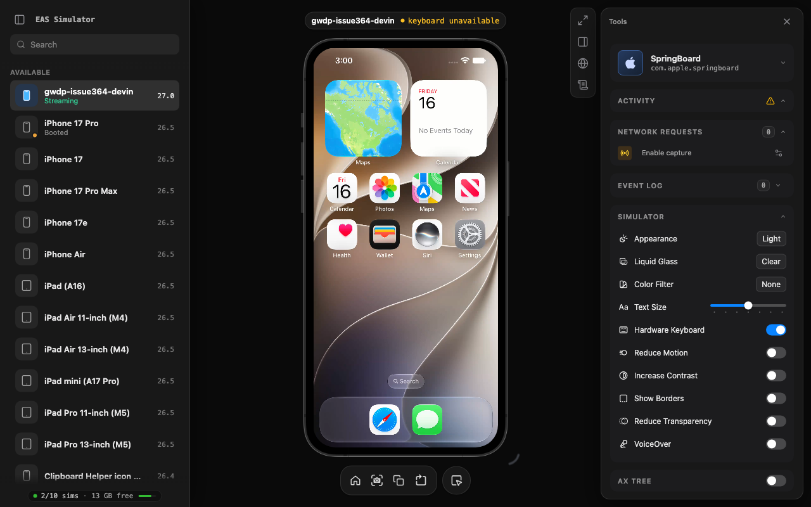

# LLP 0004: Hinge controls and display selection

**Type:** Explainer
**Status:** Active
**Systems:** ServeSim, Hub
**Author:** Imported from expo/serve-sim in #79 (original authors are in that repo); later edits by Szymon Dziedzic, Krystof Woldrich, Gabe Debes
**Date:** 2026-09-23
**Revised:** 2026-10-20 (CoreDevice hardware buttons); 2026-10-16 (ordinary iOS CoreDevice HID routing); 2026-10-13 (native recording and live preview observations); 2026-10-06 (hinge state at startup and the `serve-sim hinge` read, #139); 2026-10-02 (moved into the LLP corpus from `packages/serve-sim/packages/serve-sim/docs/hinge-controls.md`; links and paths updated)
**Related:** LLP 0001

> File paths such as `src/…` are relative to `packages/serve-sim/packages/serve-sim`, unless the text gives a path from the repository root.

The iPhone Duo's physical pose combines a **hinge angle** with the device's
orientation. Three shortcuts below the phone select Fully folded, Partially open,
and Fully open. At the top of **Simulator** settings in the Tools sidebar, the
Fold pose dropdown offers those same options plus Laptop and Tent. Hinge angle
and Table Mode follow as standard settings rows, with the decimal angle input
beside the slider. Partially open uses Device Hub's Book pose.
Both control locations share the same pending and confirmed state.

| Pose                  | Hinge angle |
| --------------------- | ----------- |
| Fully folded (Closed) | 0°          |
| Partially open (Book) | 90°         |
| Fully open (Open)     | 180°        |
| Laptop                | 90°         |
| Tent                  | 80°         |

Laptop and Book have the same hinge angle but different physical orientations.
The live slider covers 0–180°, and the numeric input accepts decimal angles.
Changing the angle preserves the current physical orientation, releases Table
Mode, and clears the selected preset. Rotating the device releases Table Mode
after applying the new orientation. Frames still follow the active display and
any orientation restrictions imposed by the foreground app.

The Table Mode toggle controls the simulator's persistent table state. Tent
enables it automatically; the other presets disable it. Its checked state uses
the acknowledged control setting, independently of observed tabletop activity.

## Live pose observation

The live preview uses native observations independently of the successful-command
cache and saved startup state. Screen config retains its command fields for the
CLI and existing clients; the additional `observedDeviceState` object is a full
native snapshot for preview. Once present, omitted fields are unknown and never
fall back to saved commands. Table Mode eligibility uses physical orientation,
independently of an app's screen rotation. Before enabling Table Mode or turning
face-down, a native getter reconciles angle and physical orientation with their latest
successful control sends. A command's value remains eligible until that field has a newer source
sample, including an unknown sample; unrelated fields and delayed delivery do not
revoke it. Observation loss and capture reset clear these temporary values. The
getter reads actor-local state without sensor queries or additional polling. Initial
orientation readback has no source timestamp, so its start/end times bound the read.
If an orientation send overlaps that interval, eligibility stays unknown until a
source sample or another orientation send is strictly after the read ends; buffered
samples inside the interval cannot resolve it. These eligibility values never
become live-preview or recording observations.

Pose subscription setup is optional to video startup. Slow or failed registration
does not block screen/input readiness or capture shutdown; registration completing
after close immediately detaches its listener. Device classification is retained
across reboot so a delayed Duo subscription still attaches its live observer.

Local controls preview their requested pose while pending. After acknowledgement,
the preview stays until native state matches or 500 ms elapses. Native display ID
owns panel and input routing as soon as the command queue drains. Late native
Laptop/Tent state initializes camera framing unless a local control already chose
it. An externally observed preset uses physical preset framing independently of
app rotation and supersedes a saved face-down view. A failed or interrupted
control batch discards queued preset framing while preserving valid camera
rotations, including rotations made while that batch was pending. Unknown native
fields alone do not invalidate the previous camera or release saved face-down
framing. Each successful preset becomes the recovery baseline for later commands;
rotations made after that preset was queued remain part of the view.
[observed: `src/device-session.ts` `applyDeviceState`, `screenConfig`;
`src/client/simulator/screen-config-state.ts` `previewScreenConfig`;
`src/client/hooks/use-duo-framing.ts` `useDuoFraming`]

Duo defaults to **3D**. The **Preview mode** selector in Simulator settings
switches between 2D and 3D and remembers the choice in the browser. The 3D view
loads Apple's `V68.usdz` from a local Xcode installation, with the live stream
on its cover or inner display. Folding, unfolding, and
switching poses animate continuously, including when a new preset interrupts a
transition. Closed presents the cover straight toward the viewer, and Open
presents the inner display straight toward the viewer. The view uses native
orientation once when connecting. Rotate controls and pose presets choose the
device's orientation. In Closed, Book (Partially open), and Open, hinge edits
smoothly turn the cover or inner screens toward the viewer while retaining the
chosen portrait/landscape orientation. Display switches and delayed orientation
updates never rotate the model.
Laptop has a level base and horizontal hinge; Tent presents the outer cover
screen with both halves descending from a horizontal ridge. In these two tabletop
modes, slider adjustments preserve the view through the closed and open endpoints.
Laptop folds around its stationary base; Tent folds symmetrically beneath its ridge.
The browser's reduced-motion preference applies pose changes immediately.

Drag either outer-edge handle to fold or unfold the 3D preview. Near closed
(30° or less), only the original handle remains visible. Both handles also
support arrow keys, Home to close, and End to open.

Raw framebuffer pixels use a fixed mapping to each physical panel: no rotation
for the cover, and a clockwise 90° rotation in canvas coordinates for the inner
display. This matches the inner panel's native 270° mounting in Y-up coordinates.
App rotation is already present in the captured pixels, so the renderer does not
apply an additional correction from app orientation or the model's viewing angle.
Stream orientation updates affect the live display, independently of the saved
model view. Rotate controls turn that view immediately without waiting for a frame.
Native frames fill their corresponding panels without changing aspect ratio;
touch coordinates use the inverse of the same mapping. The inactive display
keeps its last decoded frame while the simulator switches between cover and inner
screens. As soon as a pose requests the other display, updates to the departing
panel stop so its shutdown frames cannot replace that cached image.

Like the 2D DeviceKit artwork, the model and textures stay in the host's Xcode
installation. No model, converted copy, or offline model-editing tools are
bundled in the repository. The server serves the original USDZ at
`grid/api/devicekit-model`; the browser loads its geometry and materials and
binds the live displays and hinge in memory. No request to Apple is needed.
The model is resolved relative to Xcode's `Contents` directory at:

```text
SharedFrameworks/DeviceKit.framework/Versions/A/PlugIns/CoreDevicePopDeviceKitExtension.devicekitplugin/Contents/Resources/V68.usdz
```

`DEVELOPER_DIR` or `xcode-select -p` takes priority. If that Xcode lacks the
asset, serve-sim checks installed apps in `/Applications` and `~/Applications`.
An absent/incompatible model or WebGL failure uses the 2D preview; selecting 3D
retries loading. AX inspection also uses the flat view to align its overlays.
Laptop and Tent still apply their native settings in 2D, while their folded
device shapes are shown only in 3D.

Each control waits for acknowledgement. While dragging, the latest queued
angle replaces intermediate values; selecting a preset replaces queued slider
changes. Disconnects, failures, and timeouts discard queued changes so they
are not replayed on reconnect or on another device.

Protocol clients can select the active physical surface without moving the
hinge by sending the acknowledged hinge command `{ control: "physical", value:
"faceup" | "facedown" }`. The screen config advertises
`supportsPhysicalOrientation` when this is available, and reports the confirmed
`physicalOrientation`. Face down is accepted only while the hinge is partially
open because it uses the simulator's Table Mode sensor to elect the outer
surface. The 3D preview follows it to the cover, as it does for Tent.

With the simulator focused, Option+Shift+1–5 (⌥⇧1–⌥⇧5) select Closed, Open,
Laptop, Book, and Tent. Command+1–5 remain available for browser tab switching.

The existing CLI uses degrees and keeps its three angle aliases:

| Alias     | CLI                      | Angle | UIKit status    |
| --------- | ------------------------ | ----- | --------------- |
| Fold      | `serve-sim hinge fold`   | 0°    | `closed`        |
| Half Fold | `serve-sim hinge half`   | 90°   | `partiallyOpen` |
| Unfold    | `serve-sim hinge unfold` | 180°  | `fullyOpen`     |

The CLI also accepts an angle, such as `serve-sim hinge 120 -d <udid>`. A command
waits for an acknowledgement and reports failures instead of assuming that
writing to the input socket changed the device.

Run `serve-sim hinge` without a position to print the server's confirmed hinge
state as JSON: angle, pose, physical orientation, Table Mode, and whether Table
Mode is available. It does not move the device. Unknown fields are left out.

## Hinge state at startup

Before serve-sim reports hinge support, it reads the native hinge angle, so the
angle is correct even if the device was folded before serve-sim started.
The command-state lookup reads the native angle and uses saved physical orientation
and Table Mode. During #139, an orientation probe crashed before returning;
recording now uses a separate native observation path described below
[observed: `src/device-session.ts` `hydrateHingeState` and `applyNativeHingeState`, #139].

serve-sim therefore saves the last confirmed pose, physical orientation, and
Table Mode for each device in its state folder (`hinge-<UDID>.json`). At startup
it restores them only when the saved angle matches the native angle. A different
angle means the hinge moved while serve-sim was stopped, so the saved fields
stay unknown. The limit is that a change made outside serve-sim at the same
angle cannot be detected; choose a pose again to update the saved state
[confirmed: Gabe Debes, 2026-09-24].

Manual angle changes and rotation clear the selected pose, including after a
restart.

A hinge command that arrives before the startup read first reads native state
and the saved record, so its save keeps the saved orientation. This includes a
pose command that fails.

## Confirmed hinge state

Recording and live preview observe native pose separately from the successful-command cache and
saved startup state. It opens the hinge stream with requested 100 ms updates and
a one-degree threshold, plus a generic motion stream for physical orientation
and tabletop activity. Neither requested cadence nor injected update frequency
changes the saved timeline's four-per-second pose limit. Geometry boundaries
retain their first written frame. Ordinary iPhones skip the private motion path.

The first listener starts observation; the last cancels and awaits
teardown. Boot and connection identities reject callbacks from old producers;
independent native timestamp watermarks reject history and out-of-order angle,
motion and orientation-query samples. A failure clears observed fields and
retries after one second while a recording or live preview remains active. A stationary device's
Table activity can be unknown until a fresh motion event arrives.

Apple's native tabletop value zero (`Ambiguous`) records `tableMode: false`;
recognized values 1–10 record `true`. Missing or unrecognized values are absent.
This reports observed activity, not whether the Table Mode control is enabled.
See [recording metadata](0001-serve-sim-video-pipeline.explainer.md#device-state-metadata)
for the format and video-clock contract. Live notifications keep one dispatch in
flight and one latest full snapshot pending, independently of video backpressure.

[observed: `Sources/SimNative/CoreDeviceBridge.swift`,
`Sources/SimNative/CoreDeviceHingeReadback.swift`,
`Sources/SimNative/CoreDeviceState.swift`, `Sources/SimNative/CoreDeviceStateReadback.swift`,
`Sources/SimNative/CaptureEngine.swift`, `Sources/SimNative/DeviceStateDelivery.swift`,
`Sources/SimNative/sim-module.swift`; `Tests/SimNativeTests/DeviceStateSubscriptionTests.swift`]

## APIs inside an iOS app

The iOS 27.1 SDK provides `UIHinge`, `UIHinge.Status`, and `UIHingeInteraction`.
Attach an interaction to a view to receive the initial hinge state and later
updates. `update.hinge` can be nil when the view leaves a hierarchy that provides
hinge updates. `UIHinge.angle` is in **radians**; its status is `unknown`, `closed`,
`partiallyOpen`, or `fullyOpen`. The SDK recommends using status when only the
posture matters, because angle-update frequency and precision are system policy.

These are observation APIs for apps. They do not fold a physical device.

SwiftUI offers `onHingeChange`, whose closure receives the previous and current
hinge context. Apple calls this the **Hinge API**. Use hinge data for interactions
and effects; use scene geometry, arrangement, and region APIs for layout.

Source: `UIKit.framework/Headers/UIHinge.h` and `UIHingeInteraction.h` in the local
Xcode 27.1 beta iPhoneSimulator SDK, Apple's [UIHinge documentation](https://developer.apple.com/documentation/uikit/uihinge),
and [Leverage multiple displays and scenes on iPhone Duo](https://developer.apple.com/videos/play/tech-talks/111464/).

## Device Hub's hidden Action Bar

Xcode 27.1's Device Hub has an internal Action Bar for iPhone Duo. Enable it,
then quit and reopen Device Hub:

```sh
defaults write com.apple.dt.Devices com.apple.dt.coredevicepop.useInternalV68ActionBar -bool true
```

The bar exposes a continuous 0–180° hinge slider, five pose presets, rotation
controls, and Table Mode. The preset shortcuts and physical states are:

| Shortcut | Pose   | Angle | Physical orientation | Table Mode |
| -------- | ------ | ----- | -------------------- | ---------- |
| ⌘1       | Closed | 0°    | Portrait             | Off        |
| ⌘2       | Open   | 180°  | Portrait             | Off        |
| ⌘3       | Laptop | 90°   | Landscape left       | Off        |
| ⌘4       | Book   | 90°   | Portrait             | Off        |
| ⌘5       | Tent   | 80°   | Face down            | On         |

These orientations describe the physical device, independently of the active
panel's native rotation. A Laptop preset therefore differs from sending a 90°
hinge angle alone. Non-Tent presets release Table Mode before applying their
hinge angle and orientation. Tent sets 80°, then face down, then Table Mode.
serve-sim activates the outside display with Table Mode while holding a
landscape-left physical orientation, then waits for its orientation readback
before sending face down. This gives iOS time to rotate the cover instead of
retaining the previous portrait interface orientation. Apps that lock their
orientation still enter Tent after a bounded wait. The final physical state
remains face down.
Device Hub's hinge-slider editing callback releases Table Mode, and its
rotation control sends the new orientation before releasing Table Mode.

Table Mode is a persistent simulated state. Device Hub enables its control for
these combinations:

| Hinge state    | Physical orientations                                     |
| -------------- | --------------------------------------------------------- |
| Closed         | Landscape left or right                                   |
| Partially open | Portrait, upside down, landscape left or right, face down |
| Open flat      | Portrait                                                  |

The installed Action Bar exposes one hinge-angle slider. Its other physical
controls are presets and rotation controls; no independent pitch, roll, or yaw
sliders were found.

Device Hub changes the rotation control from Rotate Right to Rotate Left while
Option is held. serve-sim's decimal input provides fine angle adjustment directly.

A second hidden preference controls how Device Hub sends a requested angle:

```sh
defaults write com.apple.dt.Devices com.apple.dt.coredevicepop.disableHingeInterpolation -bool true
```

With this enabled, Device Hub sends the target angle in one event instead of
sweeping through intermediate angles. It does not change the 3D model or
sliders. This is a Device Hub setting; serve-sim sends the requested angle
directly and does not depend on either preference.

The pose values, Table Mode availability, and preference strings above come
from the installed Xcode 27.1 beta binary:

```text
/Applications/Xcode-27.1.0-Beta.app/Contents/SharedFrameworks/DeviceKit.framework/Versions/A/PlugIns/CoreDevicePopDeviceKitExtension.devicekitplugin/Contents/MacOS/CoreDevicePopDeviceKitExtension
```

The hidden `HingeStatePoster` wallpaper visualizes the hinge with a circular
progress indicator and state labels: 0.00 Closed, 0.50 Partial, and 1.00 Fully
Open. The installed iOS 27.1 runtime contains its extension at this path relative
to the `runtimeRoot` reported by
`xcrun simctl list runtimes --json`:

```text
System/Library/ExtensionKit/Extensions/HingeStatePoster.appex
```

Its bundle identifier is `com.apple.Posters.HingeStatePoster`. The extension
declares a Lock Screen poster with `PRSupportsGallery = false`.

## Device Hub's simulation transport

DeviceHub's internal names are `closed`, `partiallyOpen`, and `openFlat`.
Its hinge slider sends a private CoreDevice vendor-defined HID event:

- Capability: `HIDVendorDefined.send(usagePage:usage:version:data:)`.
- Usage page `0xff61`, usage `0x5b`, version `0`.
- Data: `IOCFSerialize(dictionary, 1)` of the following dictionary:

```text
provider = com.apple.Virtualization.VirtualMachines
source = hinge-slider-control
type = range
value = angle in degrees, clamped to 0...180
```

This is a private Xcode API, separate from the public UIKit APIs.

DeviceHub's orientation picker uses the same transport with
`source = orientation-picker-control`, `type = enum`, and a value of `portrait`,
`pud`, `landscape-left`, or `landscape-right`. Duo ignores the legacy GSEvent
rotation path. The picker describes physical pose, so serve-sim converts the
requested screen orientation using the active panel's profile `nativeRotation`
(0° outside, 270° inside). Native display readback remains authoritative when an
app restricts rotation.

Table Mode uses a different report: a
`CoreDeviceUtilities.CustomButtonReport` with packed usage `0x005bff61`, sent
through `UniversalHIDService` to `HIDServiceID.avpCustom`. Its `down` field is the
desired enabled state. It must be retained until the next explicit change,
rather than sent as a button press followed immediately by release.

## Selecting the stream's display

The hinge angle alone is not a reliable substitute for the active display ID.
Display changes can arrive after the sensor angle changes. Both framebuffers
remain allocated, so choosing the largest surface can stream an inactive panel.
Legacy `SimScreenProperties.backlight` was also observed to retain stale values
after a fold. CoreDevice's display information supplies the authoritative active
display and orientation; capture and touch routing must follow the same display.

A session recording follows that same active display. It uses a fixed canvas
large enough for both native panels, with even dimensions for H.264; the
smaller panel is letterboxed during fold/unfold. See
[Video pipeline and recording](0001-serve-sim-video-pipeline.explainer.md).

The 3D preview retains one model while the active stream changes between the
cover and inner displays. Pointer input is projected onto the visible active
display and mapped back to its streamed coordinates.

In the flat framed view used for AX inspection, the closed screen uses
DeviceKit's `phone15` frame; half-folded and fully open use the same `phone14`
inner-display frame. The frame and hardware buttons rotate around the stream.
The inner frame's button PDFs declare `/Rotate 270`; both asset dimensions and
PNG conversion must apply that page rotation.

## Touch transport

The Duo's legacy Indigo inner-screen target (`0x40000003`) is disconnected.
Sending input there can abort `backboardd` with “Unable to dispatch event through
disconnected service.” This was a serve-sim transport mismatch, not an inability
of the simulator to accept inner-screen input.

Foldable touch input now uses CoreDevice's `UniversalHIDServiceCapability` and
Apple's `UniversalHID.DigitizerReport` / `DigitizerContact` constructors. Reports
go to touchscreen service `0x100 + screenID`: `0x101` for the cover and `0x103`
for the inner display. Each contact retains its identity until lift. Taps,
drags, wheel-generated drags, and two-finger gestures share this path; the
selected service stays pinned through each gesture's final report. Input waits
for capture to identify a panel. Capability lookup retries transient startup
failures and never falls back to the disconnected legacy inner service.

Ordinary iOS devices with one integrated display also prefer CoreDevice touch
when its symbols, value layouts, and per-device capability are available.
Unsupported digitizers retain Indigo. CoreDevice key encoding is optional for
ordinary iOS: its absence is logged without disabling touch or falling touch
back to legacy input. Setup still opens the keyboard service, which also starts
guest HID delivery; the missing-key-encoder regression verifies actual UIKit
touch receipts. If the digitizer opens but the keyboard service itself cannot
be opened, setup fails and the session reports input as unavailable: CoreDevice
then owns guest input, so legacy sends would be acknowledged without reaching
UIKit [observed: `setupCoreDeviceHID`, `HIDInjector.setup`, `NativeHid.setScreen`]
[confirmed: Gabe Debes, 2026-10-17]. If keys cannot be encoded, native
setup reports that capability separately: `NativeHid` logs and rejects keyboard requests, config publishes
`keyboardUnavailable`, and the preview shows a keyboard-only warning while
touch remains usable. Legacy keyboard sends also failed delivery under the
reproduced ownership state, so they are not a fallback for missing CoreDevice
encoding [observed: `SimHID.setScreen`, `NativeHid`, `DeviceSession.screenConfig`,
`StreamStatusPill`; local UIKit typing probe, 2026-10-16].

The shared setup gate deliberately also disables Home, rotation, and memory
warnings after a keyboard-service lookup failure, even where their backends
could operate independently. Keeping one setup gate is an accepted simplicity
tradeoff [confirmed: Gabe Debes, 2026-10-18]. Failure stays latched until the
session is recreated; capture can continue. This is distinct from the missing
key-encoder case, which disables only keyboard input [observed:
`HIDInputSetup`, `SimHID`, `NativeHid.setScreen`].

The local preview keeps streaming with the keyboard-only warning visible
[observed: iPhone 16e, iOS 27.0, injected missing key encoder, 2026-10-16]:



Duo keeps its existing requirement for both transports
instead of falling back to its disconnected inner service.
Nonfoldable orientation stays on the legacy rotation path. Hardware buttons use
the transport described below [observed: `HIDInjector.sendOrientation`,
`sendButtonHID`].

When capture omits its optional screen ID, ordinary iOS uses the sole integrated
panel ID from the static device profile; it does not guess ID 1 or select a
virtual output. Foldables still wait for capture to identify their active panel
[observed: `SimulatorDisplayProfile.singleIntegratedScreenID`,
`HIDInjector.setScreen`; `native-no-screen` case in `hid-ownership.e2e.test.ts`].

This also avoids an ordinary iPhone's silent legacy input drop when CoreDevice
HID owns guest input. On iOS 27.0, setting/posting
`com.apple.coredevice.dtuhidd.active=1`, restarting BackBoard, and reasserting the
active owner reproduces missing UIKit touches despite a successful legacy send
and WebSocket acknowledgement. Clearing the live flag alone is not a reliable
repair. Transport selection therefore uses capabilities rather than this
notification. Serve-sim never restarts BackBoard to repair input; only the
explicitly opted-in, dedicated-device regression does so [observed:
`src/__tests__/hid-ownership.e2e.test.ts`; local published 0.9.0 middleware
reproduction, 2026-10-16].

CoreDevice capabilities belong to a boot. Every new main capture resets its
device's boot-bound cache, including ordinary devices; fixed-panel feeds share
the main session and do not reset it [observed:
`FrameCapture.start`; preview reboot case in `hid-ownership.e2e.test.ts`].

For independent checks on Xcode 27.1 beta:

```sh
xcrun devicectl device info displays --device <udid>
xcrun devicectl device motion hinge-angle --device <udid>
```

The motion command is a monitor. Its stdout can contain valid angle samples even
when a command timeout causes the final JSON report to record a timeout.

## Hardware buttons

CoreDevice touch sessions also open `ButtonHIDCapability` and send hardware
buttons through `HIDButton.sendCustomButton(usagePage:usageCode:state:)`, followed
by its barrier. Apple's `HIDButtonState(rawValue:)` constructs the resilient
state; the shim checks its metadata sizes and Optional tag before sending.
DeviceKit page/usage values pass through unchanged. Named app switcher uses
AppleVendorKeyboard `expose_All` (`0xff01/0x10`); Lock, Siri, and side button use
Consumer `power`, `voiceCommand`, and `watchSideButton` (`0x0c/0x30`, `0xcf`,
`0x95`). These mappings come from the installed CoreDevice getters, not a new
wire protocol [observed: Xcode 27.1 beta CoreDevice exported symbols and getter
disassembly; `CoreDeviceButtonShim.m`, `HIDInjector.sendButton`].

A missing button symbol or failed capability lookup leaves touch and keyboard
available, but the native button calls reject. They do not fall back to Indigo while
CoreDevice touch is selected. BackBoard can disconnect `MainScreenButtonsService`
under CoreDevice ownership and then accept host Indigo sends without delivering
them. On the owned iPhone 17 Pro / iOS 27.0 Simulator, BackBoard logged this
disconnect; #366's Indigo Lock left Settings visible, while the CoreDevice Lock
showed the Lock Screen and `expose_All` showed the app switcher [observed: local
baseline/follow-up comparison, 2026-10-19; feedback on #366,
`discussion_r4316167519`]. serve-sim's own CoreDevice touch setup is enough to
cause this: at the first input, BackBoard disconnected `ExternalKeyboardService`,
`MainScreenButtonsService`, and one `ScreenTouchService`, with serve-sim as the
only `dtuhidd` peer. With buttons on Indigo, Lock then did nothing; with buttons on
CoreDevice, Lock, app switcher, Siri, volume, and Action reached the guest, with
and without Apple's Device Hub attached, and on iPhone Duo (iOS 27.1) [observed:
fresh iPhone 17 Pro / iOS 27.0 Simulators, two runs per build, and an iPhone Duo
run, 2026-10-20]. A host barrier alone is not guest-delivery evidence.
The opt-in `core-device-buttons.e2e.test.ts` checks UIKit scene deactivation for
Lock/app switcher and actual UIKit touches with button encoding hidden.

`NativeHid` logs a rejected button and does not return the error to the
caller, as it does for every other button error. `serve-sim button`, device-frame
buttons, and hub-client buttons therefore still report success for a button that
CoreDevice could not send; the server log names the failure [observed:
`NativeHid.button`, `NativeHid.guard`]. Home still foregrounds SpringBoard;
unsupported CoreDevice touch retains the existing legacy button path [observed:
`HIDInjector.sendButton`]. The shared keyboard-service setup gate and separate
post-relaunch touch-loss follow-up are unchanged.
