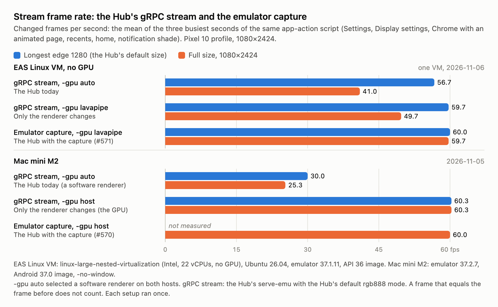

# LLP 0021: Emulator capture on Linux (x86-64)

**Type:** Explainer
**Status:** Draft
**Systems:** EmulatorCapture, ServeEmu, Hub, Release
**Author:** Claude Code (Claude Opus 5.5), directed by Krystof Woldrich
**Date:** 2026-11-04
**Revised:** 2026-11-06 (x264 build 165 from the system instead of OpenH264; rotation; `-gpu lavapipe`; the EAS emulator step; the release job; fixes from a deep review; the frame rate compared with the gRPC stream); 2026-11-14 (the frame of the post before, read on a capture thread; the read with lavapipe, from a timing matrix); all by Claude Code, directed by Krystof Woldrich; 2026-11-14 (capture-worker tail deadlines and retry ownership; shared tail pacing; loader-cache preflight), by Codex (gpt-6.1-sol), directed by Krystof Woldrich
**Related:** LLP 0000, LLP 0020, LLP 0023 (recording)

> File paths in `src/` are relative to `packages/expo-emulator-capture` unless the text names a package.

## Summary

`expo-emulator-capture` also runs on Linux x86-64. The agent is the one that [LLP 0020](0020-emulator-capture-macos.explainer.md) describes for macOS: it hooks gfxstream's display post, serves the GPC1 socket protocol with the same records and commands, keeps one consumer for each role, the stream and the recording ([LLP 0023](0023-android-recording-independent-of-stream.rfc.md#agent-protocol-3)), follows folds, and turns the picture upright for the display rotation. On Linux, the agent reads each frame back into memory and encodes it with the x264 library of the host system, build 165. While the capture is on, the Hub boots emulators with `-gpu lavapipe`.

Krystof Woldrich asked for the Linux work in a branch on top of the macOS work. He decided that the agent uses the x264 that the host has installed, as the macOS agent uses VideoToolbox, that it supports only the x264 build that EAS has, and that it fails with the install command elsewhere. He also decided on `-gpu lavapipe`, confirmed with a frame check [confirmed: Krystof Woldrich, 2026-11-05].

## Source layout

The agent core is portable C++: hook, encoder thread, socket server and protocol [observed: `src/native/agent.cpp`, `src/native/protocol.h`]. Each platform supplies a frame source and an H.264 encoder behind two interfaces [observed: `src/native/frame-source.h`, `src/native/encoder.h`]:

| Part         | macOS (LLP 0020)                                | Linux                                                     |
| ------------ | ----------------------------------------------- | --------------------------------------------------------- |
| Preload      | `DYLD_INSERT_LIBRARIES`                         | `LD_PRELOAD`                                              |
| Frame source | GPU copy into IOSurfaces; CPU readback fallback | CPU readback (`frame-source-linux.cpp`)                   |
| Frame memory | `CVPixelBuffer` (`FramePixels`)                 | Pooled RGBA images (`frame.h`)                            |
| Encoder      | VideoToolbox (`encoder-videotoolbox.mm`)        | x264 build 165 from the system (`encoder-x264.cpp`)       |
| Rotation     | `VTPixelRotationSession`                        | Turns of the I420 planes after scaling (`yuv.h`)          |
| Compiler     | `clang++`, libc++                               | `g++` (or `$CXX`), static libstdc++                       |
| Build        | `bun run build`                                 | `bun run build:linux-x64`, with the x264 build 165 header |

## Loading

- The CLI `launch` command and the Hub set `LD_PRELOAD` to the agent, ahead of any library that the caller already preloads [observed: `preloadVariable` in `src/paths.mjs`, Hub `src/server/emulator-capture.ts`]. As on macOS, the agent runs only in a process whose name starts with `qemu-system`, and it removes itself from `LD_PRELOAD` there, so that QEMU's children do not load it. `LD_PRELOAD` entries can be separated by colons or spaces [observed: `removeFromPreload` in `src/native/agent.cpp`].
- The build exports one symbol, `expo_emulator_capture_version`. A version script and `--exclude-libs,ALL` keep Gum, GLib and the static C++ library private: a preloaded library's exports take precedence over the emulator's own symbols. The library needs only `libm`, `libc` and the dynamic loader, and it references no x264 symbol [observed: `scripts/build.mjs`; `nm -D` and `readelf -d` on an EAS build, 2026-11-05].
- `eas/start_android_emulator` passes its step's environment to every program that it starts: `sdkmanager`, `avdmanager`, `adb` and the emulator [observed: eas-cli `startAndroidEmulator.ts`, `AndroidEmulatorUtils.startAsync`]. With the agent in that environment, the agent was mapped in `adb` and in QEMU, only QEMU served the socket, and the step succeeded [observed: EAS run, 2026-11-05]. The package README gives this recipe.

## Frame path

The Linux frame source reads a posted color buffer with `FrameBuffer::readColorBufferDeprecated` into a pooled RGBA image; the encoder converts, scales and turns it [observed: `src/native/frame-source-linux.cpp`]. This works with every gfxstream renderer.

The read does not run inside the post [observed: `effectiveReadMode`, `capturePost`, `captureLoop` in `src/native/agent.cpp` and `LagTail` in `src/native/lag-tail.h`]:

- A post stores its color buffer handle and hands the frame of the post before to a capture thread, which reads it. The capture thread waits for the renderer and the copy. The post does not perform that read, although it can still contend for the renderer's shared lock (see Known limitations).
- One read serves the stream and the recording ([LLP 0023](0023-android-recording-independent-of-stream.rfc.md#agent-protocol-3)). The post asks each role's pacer whether it takes the frame, and the capture thread gives the frame to the roles that did. The capture thread holds one request: a post replaces a request that the thread has not taken yet, for the roles of both. Each role keeps its limit of two pending frames.
- A frame that stays the last one for 50 ms has no post after it, so the capture thread makes it eligible at that deadline (the tail rule). It shares the ordinary post's per-role FPS budgets under a dedicated pacer mutex; if that budget is spent, the latest tail remains pending until the next sample is due. Sparse posts therefore cannot turn a 1 FPS request into 10 FPS, and the final skipped frame still arrives without another post. Every lag post wakes that worker, including a first post with no preceding frame and a post skipped by the pacer. Deadline state and condition-variable waits share one mutex, so a tail does not wait for the encoder's one-second idle timeout. Claiming a due tail happens under that mutex before readback; a new post during readback keeps its own deadline. A failed read retries only while its sequence is still current, and the final frame supersedes an older queued frame if the encoder queue is full [observed: `LagTail`, `capturePost`, `captureLoop`; regression tests in `tests/lag-tail.test.cpp`].
- At 60 FPS the preceding-frame read adds about one post (17 ms), and a last frame becomes eligible after 50 ms. At lower requested frame rates the tail can also wait for the next pacing budget; renderer contention and read time add their own delay [observed: `captureLoop`, `LagTail::pace`].

Until 2026-11-14, the read of this post's frame ran inside the post, as on macOS, so the guest waited for the renderer to finish the frame and for the copy. With `-gpu lavapipe`, that read took 5.9 to 6.9 ms [observed: agent `stats` lines, EAS runs, 2026-11-05 and 2026-11-06]. With the SwiftShader translator, a 1×1 read of the frame of the post before took 0.27–0.28 ms, against about 15 ms of wait for the frame of this post [observed: EAS VM, 2026-11-04]. On 2026-11-13, with an experiment build on EAS Linux VMs (22 vCPUs), through the Hub with a WebRTC viewer and the Hub recording at 1080×2424, on a page that changes color every frame, SwiftShader went from 50.2–51.7 to 60.0 FPS, and lavapipe from 54.5–55.0 to 56.0–56.9 FPS [observed: EAS runs, 2026-11-13].

Krystof Woldrich decided that only the Linux read changes [confirmed: Krystof Woldrich, 2026-11-14]. On the Mac mini M2 with SwANGLE, the 1×1 read of the frame of the post before still waited 22.5–24 ms, and the emulator posted 28.5 instead of 28.0 frames per second [observed: Mac mini M2, 2026-11-13]. So on macOS, the CPU read and the GPU copy stay in the post ([LLP 0020](0020-emulator-capture-macos.explainer.md#frame-paths)).

For diagnosis and measurements, the agent reads two options at each `S`. A file next to the socket wins over the emulator's environment [observed: `sessionOption` and `chooseCaptureModes` in `src/native/agent.cpp`]:

| Option | File             | Variable                      | Values                                                                                                             |
| ------ | ---------------- | ----------------------------- | ------------------------------------------------------------------------------------------------------------------ |
| Read   | `<socket>.read`  | `EXPO_EMULATOR_CAPTURE_READ`  | `post` (this post's frame, in the post), `lag` (the frame before, in the post), `lag-async` (the default on Linux) |
| Probe  | `<socket>.probe` | `EXPO_EMULATOR_CAPTURE_PROBE` | `1`: a 1×1 read before each read, which times the renderer's wait                                                  |

A file stays after the session, so remove it after a measurement.

While a consumer streams, the agent logs a `stats (capture)` line and a line for each role every 10 seconds [observed: `CaptureStats` and `EncoderStats` in `src/native/agent.cpp`]:

- `stats (capture)`: the read mode; reads per second, with tail reads and replaced requests; the capture time, with the probe's wait and the full read; the capture thread's CPU; and the render thread's ID.
- `stats (stream)` and `stats (recording)`: encoded frames per second; posts per second; the render thread's time per post in the agent and in the whole post, which includes the FrameBuffer lock and the emulator's own post work; the capture, convert and encode times; the encoder thread's CPU; frames offered to the role, and frames dropped by its pacer, by its full queue, as superseded by a newer pending frame, as older than the last encoded frame, and by its output queue; the encoded bit rate; and the time from the frame's post to the end of its encode.

The agent names its threads `expo-cap-socket`, `expo-cap-read`, `expo-enc-stream` and `expo-enc-record`. On Linux, x264's threads take the name of the encoder thread that starts them, so `/proc/<pid>/task/*/comm` shows each role's encode CPU [observed: `nameThread` in `src/native/agent.cpp`; on EAS on 2026-11-14, the `expo-enc-stream` threads used 0.70 cores at 1280 while the encoder thread alone used 52% of one core].

The macOS GPU path is not ported, for two reasons:

- The EAS Linux VM has no GPU: `/dev/dri` does not exist [observed: probe on the EAS VM, 2026-11-04].
- The GPU path needs the GLES translator's EGL functions, which are local symbols. The Linux `libgfxstream_backend.so` has no `.symtab`, only a `.gnu_debuglink`, so they cannot be resolved [observed: `readelf -S` and `nm` on emulator 37.1.11].

All the entry points that the CPU path needs are exported in the dynamic symbol table, with the same names as on macOS except one [observed: `nm -D` on emulator 37.1.11]. The exception is `readColorBufferDeprecated`, whose last parameter is a `uint64_t`: it mangles as `unsigned long long` (`y`) on macOS and `unsigned long` (`m`) on Linux. The agent picks the name from the type [observed: `kReadColorBufferDeprecated` in `src/native/gfxstream.cpp`].

## C++ runtime

The renderer is built against the emulator's own libc++: its exports use the `std::__1` namespace, and it needs `libc++.so` from the emulator's `lib64` [observed: `readelf -d` and `nm -D` on emulator 37.1.11]. `FrameBuffer::findColorBuffer` returns a libc++ `std::shared_ptr<ColorBuffer>`. This is the only C++ object that crosses from the renderer into the agent; every other call uses pointers and integers [observed: `src/native/gfxstream.h`].

The Linux agent builds with `g++` and a static libstdc++, so its `std::shared_ptr` does not match. When `_LIBCPP_VERSION` is not defined, `ColorBufferRef` stands in for the libc++ type [observed: `src/native/gfxstream.h`]:

- It has the same layout: the element pointer, then the control block pointer.
- Its destructor is user-provided, so the Itanium C++ ABI returns it through a hidden pointer, as it returns libc++'s `std::shared_ptr`.
- Its destructor calls `std::__1::__shared_weak_count::__release_shared()` from the renderer's libc++, which the emulator's `libc++.so` exports. If the symbol is missing, capture is disabled [observed: `resolveReleaseShared` in `src/native/gfxstream.cpp`].

This keeps `g++`, which the EAS image and most Linux hosts have, as the only compiler requirement. The EAS image has no `clang` [observed: probe on the EAS VM, 2026-11-04].

## Encoder

- **One x264 build.** x264 puts its build number into its library name and into a function name (`libx264.so.165`, `x264_encoder_open_165`), and its interface changes between builds [observed: `x264.h`, build 165]. The agent compiles against the build 165 header and loads `libx264.so.165` with `dlopen` [observed: `src/native/encoder-x264.cpp`]. The Linux build fails with the install command when the header is missing or has another build [observed: `scripts/build.mjs`; EAS run, 2026-11-05]. Ubuntu 26.04 ships build 165 (`libx264-165`); Ubuntu 22.04 and 24.04 ship builds 163 and 164, which do not work. The EAS image `ubuntu-26.04-jdk-17-ndk-r27b-sdk-58` has `libx264-165` 2:0.165.3222+gitb35605ac-3build1 installed, but not the header (`libx264-dev`) [observed: `dpkg -l` on EAS, 2026-11-05].
- **A missing library.** The agent tries to load x264 when a consumer connects and at each session start, and keeps it loaded once it loads. When it does not load, hello carries `encoderError` with the install command, and a failed load is tried again later, so a library that the user installs while the emulator runs works from the next session [observed: `loadX264`, `h264EncoderProblem`; `helloJson` in `src/native/agent.cpp`; EAS run, 2026-11-06]. serve-emu fails such a session with `GpuCaptureEncoderError`: a default capture uses `grpc-screenshot`, and an explicit request fails with the agent's message [observed: serve-emu `src/gpu-session.ts`, `src/middleware.ts`]. Before it boots an emulator, the Hub looks for `libx264.so.165` in absolute `LD_LIBRARY_PATH` entries, the usual library directories and the x86-64 entries of `ldconfig -p`. If that cache cannot be read or a relative search path makes the result inconclusive, it lets the agent decide with `dlopen`; a path-only miss does not disable a loader-visible library. When the preflight finds it missing, the Hub boots without the agent and the stream source select shows the install command [observed: `emulatorCaptureEncoderProblem` in Hub `src/server/emulator-capture.ts`; EAS run, 2026-11-06].
- **Settings.** Preset `ultrafast` with tune `zerolatency` (no lookahead and no B-frames, so each call returns its frame), the baseline profile (the streams decode as Constrained Baseline), average bit rate with a VBV limit at the target rate and a one-second buffer, a keyframe on request and at least every 10 seconds by timestamp, every second for the recording (x264's own interval counts frames, and a static screen posts few), SPS and PPS before every keyframe, and BT.709 limited range in the VUI. Threads: a quarter of the CPU cores, at most four, as sliced threads. x264's warnings and errors go to the agent log [observed: `configure` and `encode` in `src/native/encoder-x264.cpp`].
- **Why x264 ultrafast.** In a benchmark on an EAS Linux VM with 240 frames at 1080×2424, x264 ultrafast used 10.0 ms of CPU per frame with four threads, and Cisco OpenH264 2.6.0 used 11.1 ms. On a UI clip at a target of 8 Mbit/s, x264 reached 41.0 dB PSNR at 7.9 Mbit/s, and OpenH264 40.0 dB at 6.1 Mbit/s [observed: encoder benchmark, 2026-11-05]. The earlier Linux branch used Cisco's OpenH264 binary, whose license terms were an open question.
- **License.** x264 is GPL-2.0-or-later. The package does not contain x264 [observed: `package.json` `files`].

## Rotation

At Android's display rotation N, the panel-sized color buffer holds the picture N quarter turns clockwise ([LLP 0020](0020-emulator-capture-macos.explainer.md#rotation)). The x264 encoder scales the RGBA frame into I420 planes in the panel's orientation, then turns the planes N quarter turns counter-clockwise into the upright stream size, in 32×32 tiles [observed: `encode` in `src/native/encoder-x264.cpp`, `rotateI420` in `src/native/yuv.h`]. Turning after scaling moves 1.5 bytes for each stream pixel, not 4 bytes for each native pixel.

- A unit test turns a picture clockwise for each rotation, as the panel holds it, and checks that the turn brings it back upright, also for sizes that are not a multiple of the tile and with padded rows [observed: `tests/yuv.test.cpp`].
- On EAS, for each display rotation set with `adb shell settings put system user_rotation`, the last decoded frame of a capture with that rotation matched `screencap`: a mean difference of 0.9 to 1.2 (of 255) on a 96×43 grayscale thumbnail, and 8.7 to 13.3 for the same frame turned half a turn [observed: EAS runs, 2026-11-05 and 2026-11-06].
- Through the Hub, `POST /api/orientation` with Settings in front turned the display to rotations 1, 2, 3 and 0, and the session's rotation followed each one [observed: EAS run, 2026-11-06]. A phone's launcher stays in portrait, so the display does not turn while the home screen is in front.
- At each of the four rotations, a tap through the Hub's `POST /api/tap` at the Settings search bar, in unit coordinates of the upright display, opened the search [observed: EAS run, 2026-11-06].

## Renderer

While the capture is on, the Hub boots Linux emulators with `-gpu lavapipe`, with or without the agent [observed: `emulatorCaptureArgs` in Hub `src/server/emulator-capture.ts`]. In a renderer sweep on the EAS VM with the readback on the render thread [observed: EAS run, 2026-11-05]:

| `-gpu`        | GLES                              | Vulkan      | Stream FPS | Readback per frame | Emulator CPU |
| ------------- | --------------------------------- | ----------- | ---------- | ------------------ | ------------ |
| `lavapipe`    | ANGLE on lavapipe (Mesa llvmpipe) | lavapipe    | 60.0       | 6.9 ms             | 8.6 cores    |
| `swiftshader` | SwiftShader translator            | SwiftShader | 50.0       | 15.1 ms            | 13.5 cores   |
| `auto`        | SwiftShader translator            | lavapipe    | 30.2       | 13.3 ms            | 10.9 cores   |

With `-gpu auto`, the emulator log says `gles_mode_selected:swangle`, but its adapter line names the SwiftShader translator for GLES [observed: emulator log, EAS run, 2026-11-05].

The frame check records a page that paints each animation frame in the next of eight colors, then reads the color of every decoded frame: a frame with two colors is torn, a step of two colors is one skipped frame, and a step of zero is a repeated frame. With `-gpu lavapipe`, on an emulator that `eas/start_android_emulator` started (Pixel 6 profile, 1080×2400), no frame was torn [observed: EAS runs, 2026-11-05 and 2026-11-06]:

| Run        | Stream    | Frames | Stream FPS | Torn | One color step | Skipped (2) | Repeated (0) |
| ---------- | --------- | ------ | ---------- | ---- | -------------- | ----------- | ------------ |
| 2026-11-05 | 1080×2400 | 533    | 53.4       | 0    | 429            | 28          | 75           |
| 2026-11-05 | 576×1280  | 555    | 55.5       | 0    | 472            | 19          | 63           |
| 2026-11-06 | 1080×2400 | 539    | 54.0       | 0    | 424            | 19          | 95           |
| 2026-11-06 | 576×1280  | 544    | 54.4       | 0    | 445            | 21          | 77           |
| 2026-11-06 | 1080×2400 | 540    | 54.1       | 0    | 446            | 22          | 71           |
| 2026-11-06 | 576×1280  | 550    | 55.1       | 0    | 465            | 22          | 62           |

### The read with lavapipe

On 2026-11-14, a timing matrix measured each part of the frame path with `-gpu lavapipe`, on the page that paints each frame in the next of eight colors, with Chrome's own frame counter read through DevTools. The EAS VM (`linux-large-nested-virtualization`) had 22 vCPUs: an Intel Xeon Platinum 8481C with 11 cores and 2 threads per core, under KVM. The agent came from a later PR of the stack, with the stream and recording roles and per-part timings; [LLP 0023](0023-android-recording-independent-of-stream.rfc.md#test-plan-and-results) has the full tables [observed: EAS runs, 2026-11-14]:

- With the Pixel 10 profile (1080×2424), a read took 8.6 to 9.5 ms. A 1×1 read before it took 5.5 to 6.2 ms, so most of the read is a wait for the renderer, also for the frame of the post before. With the Medium Phone that EAS sessions use (720×1600 at 300 ppi), a read took 3.2 to 3.4 ms, of which 2.3 to 2.4 ms was the wait.
- On the Pixel 10, Chrome drew 59.7 frames per second without a consumer. With every frame read and a stream of 16 pixels, which needs almost no encode, it drew 55.3; with the same read in the post, 55.1; with 30 reads per second, 59.7. So the read costs the guest frames wherever it runs. A likely reason is that each read makes lavapipe finish its queued work [inferred].
- With a 1280 stream, the read on the capture thread kept the read off the render thread: 0.00 ms in the agent per post, against 8.4 ms with the read in the post. Chrome drew 52.9 and 53.0 frames per second, and the emulator posted 58.8 and 58.0. A frame took 37 ms from its post to the end of its encode, against 19 ms with the read in the post: the frame waits for the next post.
- With the Medium Phone, Chrome drew 60.0 frames per second in every variant, with and without capture.

## Frame rate compared with the gRPC stream

Without the capture, the Hub streams an emulator from the emulator's gRPC screenshot stream, and it boots emulators with `-no-window -gpu auto` [observed: `buildEmulatorArgs` in `packages/@expo/hub-android-utils/src/emulator.ts`]. One EAS run compared that stream with the capture on one VM. Every recording used the same app-action script (Settings, Display settings, Chrome with an animated page, recents, home and the notification shade) and the Pixel 10 profile [observed: EAS run, 2026-11-06]. The Mac rows come from the same script on the Mac mini M2 [observed: research runs, 2026-11-05].

| Host         | Source           | `-gpu`     | 570×1280     | 1080×2424 |
| ------------ | ---------------- | ---------- | ------------ | --------- |
| EAS Linux VM | gRPC stream      | `auto`     | 56.7         | 41.0      |
| EAS Linux VM | gRPC stream      | `lavapipe` | 59.7         | 49.7      |
| EAS Linux VM | Emulator capture | `lavapipe` | 60.0         | 59.7      |
| Mac mini M2  | gRPC stream      | `auto`     | 30.0         | 25.3      |
| Mac mini M2  | gRPC stream      | `host`     | 60.3         | 60.3      |
| Mac mini M2  | Emulator capture | `host`     | not measured | 60.0      |

- Each value is the mean of the three busiest seconds, in changed frames per second. A frame that equals the frame before does not count (ffmpeg `mpdecimate` on copies scaled to 570 pixels wide). The gRPC recordings come from the Hub's serve-emu with the Hub's default `rgb888` image mode. The capture recordings come from the agent's socket, with the time of each frame.
- On the EAS VM, at full size, the gRPC stream reached 41.0 with `-gpu auto` and 49.7 with `-gpu lavapipe`, and the capture reached 59.7. At the Hub's default size, all three Linux setups reached 56.7 to 60.0.
- With `-gpu auto`, the EAS VM used the SwiftShader translator for GLES, and the Mac used SwANGLE ([LLP 0020](0020-emulator-capture-macos.explainer.md#frame-paths)). Both are software renderers [observed: emulator logs of these recordings, 2026-11-05 and 2026-11-06].
- Each setup ran once. The Linux and the Mac rows used different emulator versions and system images: 37.1.11 with API 36 on Linux, 37.2.7 with Android 37.0 on the Mac.

## Integration

- **Hub.** `--experimental-emulator-capture` also works on `linux-x64`. On Linux, the Hub preloads the agent with `LD_PRELOAD`, adds `-gpu lavapipe`, installs the package's Linux agent (`dist/linux-x64/libexpo_emulator_capture.so`), and checks for x264 before each boot [observed: Hub `src/server/emulator-capture.ts`, `src/server/emulator-capture-install.ts`]. The socket directory is `<tmpdir>/expo-emulator-capture`, as on macOS; on EAS, `TMPDIR` is not set, so it is `/tmp/expo-emulator-capture` [observed: EAS run, 2026-11-05].
- **Attach.** An emulator that started without the agent gets it from gdb when the user opens it, if Yama's `ptrace_scope` allows it ([LLP 0019](0019-emulator-capture-attach.explainer.md#linux)).
- **serve-emu.** The Linux agent needs no other change: the protocol, the rotation reads and the touch mapping are the same as on macOS. An emulator that an EAS step started with the agent became the Hub's default capture source [observed: EAS run, 2026-11-05].

## Release

- The generic `build` task builds only the macOS agent and warns on other hosts, so Linux CI, which builds every package, needs no x264 header. The Linux agent has its own task, `build:linux-x64`, which fails on any other host [observed: `scripts/platform.mjs`, `package.json`].
- The two agents need separate Turborepo cache entries, because the cache key does not include the host. `turbo.json` declares `expo-emulator-capture#build:linux-x64` with `dist/linux-x64/**` as its output [observed: `turbo.json`].
- The release cache workflow has a second job on an Ubuntu 26.04 image. It installs `libx264-dev`, applies the same version steps as the macOS job, and runs only the Linux task with `--force`. The release job restores it, then checks that both agents exist before the version commit [observed: `.eas/workflows/build-release-cache.yml`, `.github/workflows/release.yml`, `scripts/check-dist.mjs`]. The PR reports a canary release run on 2026-11-06; that evidence predates the current tail changes [observed: the Evidence section of https://github.com/expo/expo-device-hub/pull/571].

## Known limitations

- Each frame reaches the consumer one post later, and the last frame before a still screen 50 ms later ([Frame path](#frame-path)).
- The read still copies every frame on the CPU, and the renderer's read takes the FrameBuffer lock, which the post also takes. So a post that comes during a read can wait for it [inferred: from the shared lock on macOS ([LLP 0020](0020-emulator-capture-macos.explainer.md#locking))]. On the Pixel 10 with lavapipe, the whole post took 1.0 to 1.2 ms with the read on the capture thread, and 0.1 ms on the Medium Phone, whose read is shorter [observed: EAS runs, 2026-11-14].
- With lavapipe at 1080×2424, reading every frame costs the guest about 4 of its 60 frames per second ([The read with lavapipe](#the-read-with-lavapipe)).
- Tested only on EAS Linux VMs (Ubuntu 26.04, Intel, 22 vCPUs, no GPU) with emulator 37.1.11. A Linux host with a GPU and `-gpu host` is not tested.
- Only x264 build 165. Hosts with another build fail with the install command.
- No hardware encoder: VAAPI and NVENC are not used.
- One socket path serves one emulator. `eas/start_android_emulator` with `count` above 1 starts every emulator with the same environment, so only one of them can serve the socket [inferred: from `listen` in `src/native/agent.cpp`, which refuses a socket that another agent serves; not tested].
- Where `TMPDIR` is not set, all users of a host share `/tmp/expo-emulator-capture`. The agent and the Hub refuse a socket directory that another user owns or can write ([LLP 0020](0020-emulator-capture-macos.explainer.md#loading)), so the first user's directory blocks the others; each user then needs a private `TMPDIR` [observed: `listen` in `src/native/agent.cpp`; README].

## Open questions for the maintainer

- Should the agent name its socket by the console port, so that one EAS step can start several emulators with the agent?
- Should the Linux agent use VAAPI or NVENC, or `-gpu host`, when the host has a GPU?
