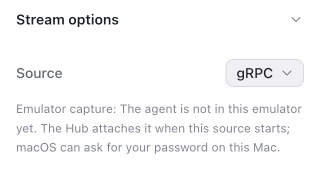

# LLP 0022: Attach the emulator capture agent to a running emulator

**Type:** Explainer
**Status:** Draft
**Systems:** EmulatorCapture, ServeEmu, Hub, HubClient, HubComponents
**Author:** Claude Code (Claude Opus 5.5), directed by Krystof Woldrich
**Date:** 2026-11-06
**Revised:** 2026-11-13 (the agent serves one consumer for each role, after LLP 0023)
**Related:** LLP 0020, LLP 0021, LLP 0023

## Summary

[LLP 0020](0020-emulator-capture-macos.explainer.md) and [LLP 0021](0021-emulator-capture-linux.explainer.md) load the capture agent when the Hub starts an emulator. An emulator that started some other way, for example from Android Studio or before the Hub, has no agent, and the Hub streamed it with gRPC. With the capture on, the Hub now loads the agent into such an emulator's running QEMU process when the user opens the emulator: with lldb on macOS and with gdb on Linux.

Krystof Woldrich decided the shape: while the flag or the variable turns the capture on, the stream source select shows the capture for these emulators, and opening the emulator attaches the agent [confirmed: Krystof Woldrich, 2026-11-06].

## How the agent loads

The debugger stops QEMU, calls `setenv` for `EXPO_EMULATOR_CAPTURE_SOCKET` and `EXPO_EMULATOR_CAPTURE_LOG`, calls `dlopen` on the agent library with `RTLD_NOW`, reads `dlerror()`, and detaches [observed: `emulatorCaptureAttachCommand` in Hub `src/server/emulator-capture-attach.ts`]. `dlopen` runs the agent's constructor, which reads the two variables as it does after a preload, so the agent needs no change: it hooks gfxstream's post, listens on the socket, and writes its log next to it [observed: `expoEmulatorCaptureInit` in `packages/expo-emulator-capture/src/native/agent.cpp`; a manual lldb attach on the Mac mini M2, 2026-11-06].

- The socket and the log have the same names as for a boot, so serve-emu finds the attached agent by serial [observed: `attachEmulatorCapture`].
- The emulator keeps the renderer it started with. An emulator with a software renderer gets the CPU frame path ([LLP 0020](0020-emulator-capture-macos.explainer.md#frame-paths)).
- A library that the process loaded already does not run its constructor again. So an emulator that the Hub started with the agent, where the agent turned itself off, gets nothing from an attach. On Linux the Hub reads `/proc/<pid>/maps` and does not attach to such a process; on macOS the agent's log then gives the reason [observed: `attachEmulatorCapture`].

## Router

serve-emu's `emulatorCapture` options get `attach` and `attachNote` [observed: `EmulatorCaptureOptions` in serve-emu `src/device-capabilities.ts`]:

- `attach({ serial, processId })` resolves when the agent serves the socket, and rejects with a reason for the user. The process comes from the emulator's discovery file `pid_<pid>.ini`, which QEMU writes; on the Mac, that process was `qemu-system-aarch64-headless`. An emulator without gRPC, for example one started from the command line, has not written that file, but the console command `avd discoverypath` names its path, with the process ID, before the file exists [observed: `findEmulatorProcessId` in `src/emulator-grpc.ts`; emulator 37.2.7 on the Mac mini M2, 2026-11-06].
- With `attach`, an emulator without a socket offers `emulator-capture` in `availableModes`, and `/api/stream-mode` adds `modeNotes["emulator-capture"]`: the `attachNote`, or why the last attach failed [observed: `streamModeAvailability` in `src/middleware.ts`].
- With the capture as the default source, a session for such an emulator first attaches. A failed attach does not fail the session: the emulator streams with `grpc-screenshot`, and an explicit capture choice from before is dropped [observed: `getAppUnqueued`].
- The router remembers the failure with the process that it tried. That process does not attach again by itself, so a user who closed a password dialog is not asked again at every request. When the process ends, for example when the emulator restarts, the failure ends with it [observed: `attachFailureFor`].
- Selecting the capture (`PUT /api/stream-mode`) attaches again, also after a failure, and fails with the reason. Concurrent callers share one attempt [observed: `performStreamModeSwitch`, `attachCapture`].
- `/api/stream-mode` for an emulator that has no session yet starts one, so opening the emulator in the Hub is what attaches [observed: the `GET` handler and `getAppUnqueued`].

## macOS

- The Hub runs `lldb --batch --no-lldbinit --attach-pid <pid>` [observed: `emulatorCaptureAttachCommand`]. lldb comes with the Xcode Command Line Tools; without it, the reason names `xcode-select --install`.
- Attaching needs `task_for_pid`. On the development Mac, the `system.privilege.taskport` right asks a member of `_developer` for a password, once per 10 hours for the session (`shared`, `timeout 36000`). `sudo DevToolsSecurity -enable` removes the dialog for those members [observed: `security authorizationdb read system.privilege.taskport`, `DevToolsSecurity` man page, 2026-11-06]. The dialog shows on the Mac's screen, not in the browser, so the note says that macOS can ask for a password on this Mac.
- Emulator 37.2.7's QEMU has `get-task-allow` and `disable-library-validation`, so lldb can attach and an ad-hoc signed agent loads ([LLP 0020](0020-emulator-capture-macos.explainer.md#loading)).
- The debugger may wait 180 seconds, for the password.
- lldb passes QEMU's asynchronous signals through without stopping (`process handle --stop false --pass true --notify false SIGUSR1 …`), as gdb does on Linux, where a stop crashed QEMU (below). On the Mac, with a scrolling load, ten lldb runs with harmless calls (`getpid`, `dlopen` of libz) each got their result, and QEMU kept running [observed: Mac mini M2, emulator 37.2.7, 2026-11-06].

## Linux

- The Hub runs `gdb --batch --nx -p <pid>` with `set auto-solib-add off` and `sharedlibrary libc\.so`, so that gdb loads only libc's symbols instead of every library that the emulator maps; `set unwindonsignal on` unwinds a call that a fault interrupts [observed: `emulatorCaptureAttachCommand`]. On the EAS VM, the calls took about one second [observed: EAS run, 2026-11-06]. Without gdb, the reason names `sudo apt install gdb`.
- QEMU kicks its vCPU threads with `SIGUSR1`. With gdb's default handling, that signal stops gdb when it arrives in another thread during a call: gdb then gives up the call, and after the detach QEMU crashed with a segmentation fault [observed: gdb output, EAS run, 2026-11-06]. So the Hub passes QEMU's asynchronous signals through without stopping (`handle SIGUSR1 SIGUSR2 SIGALRM … SIG44 nostop noprint pass`), and the calls run as the process runs normally [observed: `PASSED_SIGNALS`]. With a scrolling load on one emulator, 20 of 20 runs with harmless calls (`getpid`, `dlopen` of libm) got their result with the signals passed through, and QEMU kept running; with the default handling, QEMU then crashed after five runs. A second test with the default handling crashed QEMU the same way [observed: EAS runs, 2026-11-06].
- With Yama's `kernel.yama.ptrace_scope` at 1, the default on Ubuntu, a process may trace only its descendants, and gdb is not an ancestor of QEMU. The Hub reads the setting before it runs gdb and gives the command that allows it, `sudo sysctl kernel.yama.ptrace_scope=0`, or tells the user to start the emulator from the Hub. Root may always attach [observed: `linuxPtraceProblem`].
- The library check before an attach is the same as before a boot: without x264 build 165, the attach fails with the install command ([LLP 0021](0021-emulator-capture-linux.explainer.md#encoder)).

## Hub

- `--experimental-emulator-capture` or `EXPO_DEVICE_HUB_EXPERIMENTAL_EMULATOR_CAPTURE=1` gives serve-emu the `attach` function and the note [observed: Hub `src/server/serve-emu.ts`].
- An attach first installs the agent package, as a boot does, and checks that the socket directory is private ([LLP 0020](0020-emulator-capture-macos.explainer.md#loading)). It then runs the debugger, reads `dlopen`'s result from its output, and waits up to 15 seconds for the socket. When no socket appears, the reason comes from the agent's log lines since the attach began, for example a `capture disabled:` line [observed: `attachEmulatorCapture`, `parseAttachOutput`].
- The stream source select shows a source's note under it, as it shows the reason for a source that is not available. The capture stays selectable, so that selecting it tries again [observed: `StreamOptionsSection` in `packages/@expo/hub-components/src/dashboard/StreamOptionsSection.tsx`; `parseAndroidStreamSource` in `packages/@expo/hub-client/src/android-stream-source.ts`].

## Known limitations

- The debugger calls `dlopen` in a thread that it interrupted. If another thread holds the dynamic loader's lock at that moment, the call waits for that lock [inferred: from how `dlopen` locks; not observed].
- The Hub kills a debugger that runs longer than its timeout: 180 seconds on macOS, so that the user can type the password, and 90 seconds on Linux [observed: `DEBUGGER_TIMEOUT_MS` in `src/server/emulator-capture-attach.ts`]. If a call still runs at that moment, QEMU can crash, as it did when gdb gave up a call [inferred].
- Only one Hub should attach to an emulator at a time. The agent serves one stream consumer and one recording consumer ([LLP 0020](0020-emulator-capture-macos.explainer.md#socket-protocol)), so a second Hub replaces the first Hub's stream, and the first Hub's recording goes on [observed: two-Hub test in https://github.com/expo/expo-device-hub/pull/624].
