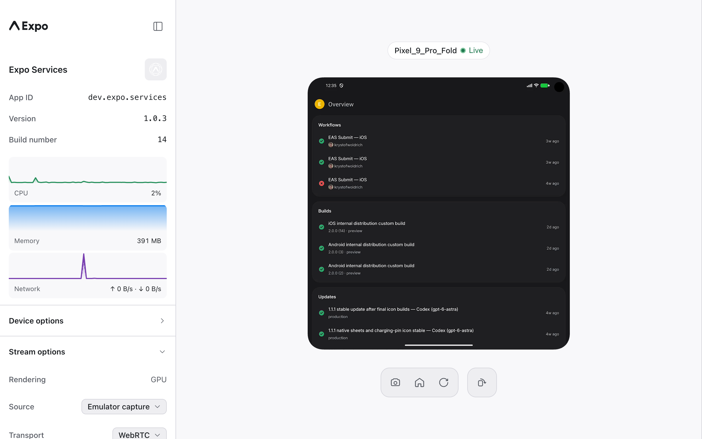
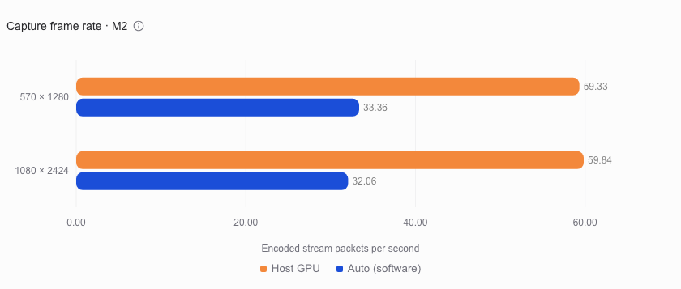
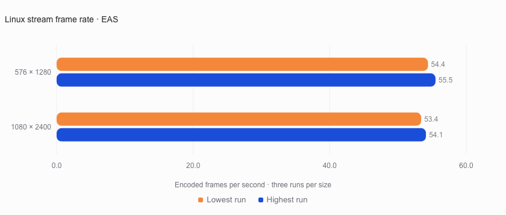

# expo-emulator-capture

Experimental Android Emulator screen capture for **macOS on Apple silicon** (M1, M2,
M3, M4 and later) and **Linux x86-64**.

- On macOS, it copies each displayed frame on the GPU when the emulator renders with the
  host GPU, and encodes it to H.264 with VideoToolbox, on the hardware encoder when the
  Mac has one.
- On Linux, it reads each frame back from the emulator's renderer and encodes it with the
  system's x264 library, build 165.

[Expo Device Hub](../expo-device-hub) streams emulators through it when you turn on its
experimental emulator capture.

This package is separate from the Hub, not a dependency of it. The Hub installs it when
you turn the capture on. The design is in
[LLP 0020](../../llp/0020-emulator-capture-macos.explainer.md) (macOS) and
[LLP 0021](../../llp/0021-emulator-capture-linux.explainer.md) (Linux).

## Use with Expo Device Hub

Turn on the capture with the flag, or with the variable for `expo start`:

```sh
npx expo-device-hub --experimental-emulator-capture
EXPO_DEVICE_HUB_EXPERIMENTAL_EMULATOR_CAPTURE=1 npx expo start
```

With the capture on, the Hub:

- installs the matching version of this package with npm, into
  `~/.cache/expo-device-hub/tools/expo-emulator-capture/<version>`, the first time;
- boots emulators with `-gpu host` on macOS and `-gpu lavapipe` on Linux, and with the
  agent once the package is installed (on Linux, also once x264 build 165 is). The agent
  logs to `<tmpdir>/expo-emulator-capture/<serial>.log`;
- streams each emulator that has an agent through it, with scrcpy for input, and makes
  "Emulator capture" the default stream source. Emulators without the agent use gRPC.

The Hub shows "Emulator capture" in the stream source select for every emulator. When the
source cannot work, it is disabled, and a note below the select says why and what to do:
for example, restart the Hub with the flag, or restart an emulator that started without
the agent from the Hub. When the agent turned itself off, for example because an emulator
update removed a renderer symbol that it needs, the note gives the agent's reason.

To use a library that you built, name it instead of the installed package:

```sh
EXPO_DEVICE_HUB_EMULATOR_CAPTURE_LIBRARY="$PWD/dist/darwin-arm64/libexpo_emulator_capture.dylib" \
  npx expo-device-hub --experimental-emulator-capture
```

`/health` on the serve-emu routes reports `captureBackend: "expo-emulator-capture"` and
the capture diagnostics (`framePath`, encoder, native and stream size, resizes, rotation).

<picture>
  <source media="(prefers-color-scheme: dark)" srcset="https://raw.githubusercontent.com/expo/expo-device-hub/92849c5f2db45cf9d83c2abf5b358067fee0b32f/packages/expo-emulator-capture/docs/device-hub-emulator-capture.png">
  
</picture>

## Measurements

### macOS

Mac mini M2 (8 GB), Pixel 10, Android Emulator 37.2.7; historical measurements from
2026-11-04–05.



60 FPS requested over 20-second animation sessions; values are encoded stream packet rates.


CPU overhead was about 58% lower at 1280 and 76% lower at native size (three rounds,
both `-gpu host`). System-wide measurements include background activity; CLI recording
versus gRPC + x264, not full Hub/WebRTC or CPU per frame. [Data and methods](https://raw.githubusercontent.com/expo/expo-device-hub/d66897959c6d81d2d3042181d6d9885a6a97ae3d/packages/expo-emulator-capture/docs/measurements.json).

### Linux

EAS Linux VM (22 vCPUs, no GPU), Pixel 6, Emulator 37.1.11, `-gpu lavapipe`,
2026-11-05–06. Three runs per size, using the earlier synchronous read; these predate
the capture-worker and tail fixes. [Newer timing matrix](../../llp/0021-emulator-capture-linux.explainer.md#frame-path).



Every decoded animation frame was checked; none was torn. Readback took 5.9–6.9 ms;
conversion and encoding took 9.5–9.8 ms at 576×1280. [Data and methods](https://raw.githubusercontent.com/expo/expo-device-hub/105afe3e6cec1eb4c1deaacfff0e9a9a569c28d9/packages/expo-emulator-capture/docs/linux-measurements.json).

## How it works

```text
macOS: display post → GL texture → GPU copy into an IOSurface
         → VideoToolbox rotation, scale and NV12 conversion → H.264 (hardware)
Linux: display post → queue the previous post's handle → capture-worker readback (RGBA)
         → scale and I420 conversion → rotation → x264 → H.264
then:  Unix socket → serve-emu → Device Hub (WebCodecs or WebRTC)
```

- A small agent library is preloaded into the emulator's QEMU process with
  `DYLD_INSERT_LIBRARIES` on macOS and `LD_PRELOAD` on Linux. It hooks the renderer's
  display post with Frida Gum. The emulator itself is not modified.
- With `-gpu host`, the renderer's frames are OpenGL textures. The agent copies each
  frame into an IOSurface on the GPU; the CPU never touches the pixels.
- With a software renderer (`-gpu auto` on a headless Mac picks SwANGLE), the agent
  reads the pixels back instead. Encoding still uses the hardware encoder.
- A Mac without a usable hardware encoder gets the VideoToolbox software encoder.
  The `configured` record and the agent log say which encoder runs.
- On Linux, the agent reads every frame back with the renderer's own readback, on the
  capture worker, using the preceding post's handle. A last post becomes eligible after
  50 ms without another post, within the same requested FPS budget. The worker can still
  contend with the renderer for its lock. It loads x264 when a consumer connects; when x264 is missing,
  the first record says so, and a later connection tries again.
- A consumer connects to the agent's socket, sets the stream size, frame rate and bit
  rate, and receives H.264. Consumers can disconnect and reconnect at any time.
- The agent serves two consumers at once, each with its own encoder and settings: the live
  stream and the recording. The agent copies each frame once for both. The recording keeps
  the panel orientation and one canvas size, places each frame on it with black borders, and
  has a keyframe at least once a second. Expo Device Hub records Android this way, so stream
  changes, rotations and folds do not end its recording.
- When a foldable folds or unfolds, the display size changes. The agent reconfigures
  the encoder and tells the consumer the new size.
- When Android turns the display, the consumer sends the display rotation, and the agent
  turns the picture upright before it encodes it.

## Requirements

| Host                       | Renderer that the Hub selects | Encoder                         | To install                                   |
| -------------------------- | ----------------------------- | ------------------------------- | -------------------------------------------- |
| macOS 13+ on Apple silicon | `-gpu host`                   | VideoToolbox, part of macOS     | Nothing                                      |
| Linux x86-64               | `-gpu lavapipe`               | x264 build 165, from the system | Ubuntu 26.04: `sudo apt install libx264-165` |

x264 changes its interface with every build, so the Linux agent supports build 165 only.
Ubuntu 26.04 ships it; Ubuntu 24.04 ships build 164, which does not work. Without it, the agent
reports the install command. The Hub preflight checks standard paths and the loader cache;
a confirmed absence boots without the agent and shows the command below the source select.
An inconclusive preflight lets the agent try the actual loader.

## Start an emulator without the Hub

The agent loads only when the emulator starts with it. To start an emulator yourself,
for example in a CI job before the Hub starts, install the package and launch the
emulator through it. Pass `-port`, so the socket is named after the emulator's serial:

```sh
npm install expo-emulator-capture
npx expo-emulator-capture launch -- -avd Pixel_9 -no-window -gpu host -port 5554
```

On Linux, use `-gpu lavapipe` instead of `-gpu host`.

Or set the two variables on the emulator command yourself (on Linux, `LD_PRELOAD` with
`dist/linux-x64/libexpo_emulator_capture.so`):

```sh
DYLD_INSERT_LIBRARIES="$PWD/node_modules/expo-emulator-capture/dist/darwin-arm64/libexpo_emulator_capture.dylib" \
EXPO_EMULATOR_CAPTURE_SOCKET="$(npx expo-emulator-capture socket-path --port 5554)" \
  emulator -avd Pixel_9 -no-window -gpu host -port 5554
```

Both use the socket `<tmpdir>/expo-emulator-capture/emulator-5554.sock`, the place where
the Hub looks for it. Then start the Hub with the capture on; it streams the running
emulator through the agent.

On macOS, set the variables on the emulator command itself. A protected system program
in between, such as `nohup` or a `/bin/sh` that receives the variables, removes `DYLD_*`
variables, and then the agent does not load.

### On a host that several users share

The socket directory, `<tmpdir>/expo-emulator-capture`, must belong to the user alone (mode
0700): the agent and the Hub refuse a directory that another user owns or can write. Where
`TMPDIR` is not set, as on most Linux hosts, all users share `/tmp`, so the first user's
directory blocks the others. Give each user a private `TMPDIR`.

## Record without the Hub

Record an emulator's stream to an H.264 file:

```sh
npx expo-emulator-capture record --socket "$(npx expo-emulator-capture socket-path --port 5554)" \
  --output /tmp/capture.h264 --seconds 10 --fps 60 --max-size 1280
```

`--rotation 1` (0 to 3, Android's display rotation) asks the agent to turn the picture
upright for a rotated display. `--role recording` takes the recording consumer instead of
the stream, so a Hub that streams the same emulator does not replace it; `--canvas
1200x2424` sets its fixed canvas. Set `EXPO_EMULATOR_CAPTURE_LOG=/path/to/file` to write the
agent's log to a file. It logs to the emulator's standard error otherwise.

## Build and test

Run from this package directory. You need Bun. The builds download the pinned Frida Gum
devkit for the host and check its SHA-256 digest.

```sh
bun run build             # macOS with Apple silicon and Xcode command line tools:
                          # dist/darwin-arm64/libexpo_emulator_capture.dylib
bun run build:linux-x64   # Linux x86-64 with g++ and the x264 build 165 header
                          # (Ubuntu 26.04: sudo apt install libx264-dev):
                          # dist/linux-x64/libexpo_emulator_capture.so
bun run test              # protocol, conversion and rotation unit tests (C++ and JavaScript)
```

`bun run build` builds only the macOS agent; on other hosts it prints a warning and
produces no binary. `bun run build:linux-x64` fails on any host but Linux x86-64. The
release builds the macOS agent on an EAS macOS job and the Linux agent on an EAS Linux
job, and fails without either.

## Limitations

- Tested only with Android Emulator 37.2.7 (build 16195039) on macOS and 37.1.11 on
  Linux. The agent uses private renderer symbols; it refuses to capture when they are
  missing.
- The agent loads only when the emulator starts with it. Attaching to an emulator that is
  already running is not implemented.
- Only the main display is captured. One consumer for each role, the stream and the
  recording: a new consumer replaces the one of its role, which gets a `replaced` record
  first. The Hub then streams that emulator with gRPC until you select "Emulator capture"
  again, so two Hubs do not take the capture from each other in a loop.
- The EAS macOS VMs cannot run the Android Emulator (Hypervisor.framework reports
  `HV_UNSUPPORTED` there), so the macOS agent was tested only on a physical Mac.
- The Linux agent was tested only on EAS Linux VMs without a GPU. It reads every frame
  back on the renderer's thread, and it supports only x264 build 165.

## Licenses

This package has mixed licenses. Expo's own code is [MIT-licensed](LICENSE). The prebuilt
agent libraries also contain third-party components under their own licenses, among them
Frida Gum (wxWindows 3.1, an LGPL-2.0+ license with a binary exception) and GLib
(LGPL-2.1+). [THIRD_PARTY_LICENSES.md](THIRD_PARTY_LICENSES.md) lists every component,
with the license texts in `LICENSES/`. The Linux agent loads x264 (GPL-2.0-or-later) from
the host system; the package does not contain it.

### Temporary Linux PBO experiment

Set `EXPO_EMULATOR_CAPTURE_PBO=1` in the emulator's environment, or write `1` to
`<socket>.pbo` before a consumer starts, to test PBO readback on emulator 37. This
forces `lag-async`, submits a GLES pixel-buffer copy under the renderer lock, and
waits/maps on a capture thread after releasing that lock. It is opt-in and fails
explicitly if its private renderer entry points are unavailable. Remove the file
and variable before a new session to return to the default reader.

This prototype copies mapped bytes into the shared encoder pool; its performance
must include that cost. See [LLP 0023](../../llp/0023-android-recording-independent-of-stream.rfc.md#pbo-experiment)
for the experiment and measurements.
