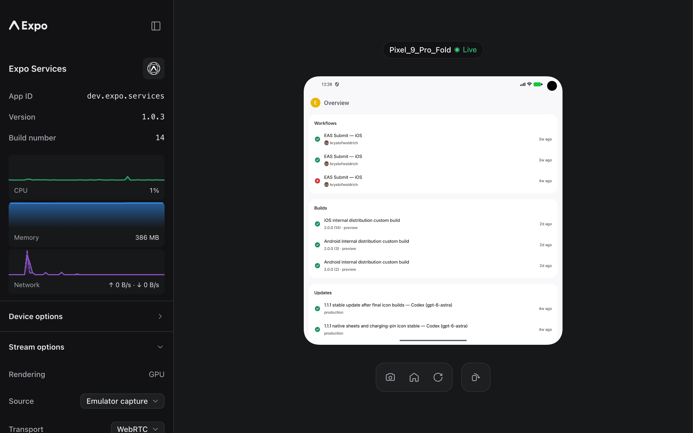
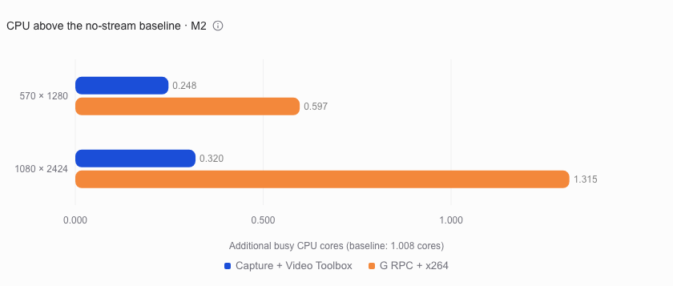

# expo-emulator-capture

Experimental Android Emulator screen capture for **macOS on Apple silicon** (M1, M2,
M3, M4 and later). It copies each displayed frame on the GPU when the emulator renders
with the host GPU, and encodes it to H.264 with VideoToolbox, on the hardware encoder
when the Mac has one.
[Expo Device Hub](../expo-device-hub) streams emulators through it when you turn on its
experimental emulator capture.

This package is separate from the Hub, not a dependency of it. The Hub installs it when
you turn the capture on. The design is in
[LLP 0020](../../llp/0020-emulator-capture-macos.explainer.md).

## Use with Expo Device Hub

Turn on the capture with the flag, or with the variable for `expo start`:

```sh
npx expo-device-hub --experimental-emulator-capture
EXPO_DEVICE_HUB_EXPERIMENTAL_EMULATOR_CAPTURE=1 npx expo start
```

With the capture on, the Hub:

- installs the matching version of this package with npm, into
  `~/.cache/expo-device-hub/tools/expo-emulator-capture/<version>`, the first time;
- boots emulators with `-gpu host`, and with the agent once the package is installed. The
  agent logs to `<tmpdir>/expo-emulator-capture/<serial>.log`;
- streams each emulator that has an agent through it, with scrcpy for input, and makes
  "Emulator capture" the default stream source. Emulators without the agent use gRPC.

The Hub shows "Emulator capture" in the stream source select for every emulator. When the
source cannot work, it is disabled, and a note below the select says why and what to do:
for example, restart the Hub with the flag, or restart an emulator that started without
the agent from the Hub. When the agent turned itself off, for example because an emulator
update removed a renderer symbol that it needs, the note gives the agent's reason.

To use a library that you built, name it instead of the installed package:

```sh
EXPO_DEVICE_HUB_EMULATOR_CAPTURE_LIBRARY="$PWD/dist/darwin-arm64/libexpo_emulator_capture.dylib" \
  npx expo-device-hub --experimental-emulator-capture
```

`/health` on the serve-emu routes reports `captureBackend: "expo-emulator-capture"` and
the capture diagnostics (`framePath`, encoder, native and stream size, resizes, rotation).



## Measurements

Mac mini M2 (8 GB), Pixel 10, Android Emulator 37.2.7; historical measurements from
2026-11-04–05.


60 FPS requested over 20-second animation sessions; values are encoded stream packet rates.



CPU overhead was about 58% lower at 1280 and 76% lower at native size (three rounds,
both `-gpu host`). System-wide measurements include background activity; CLI recording
versus gRPC + x264, not full Hub/WebRTC or CPU per frame. [Data and methods](https://raw.githubusercontent.com/expo/expo-device-hub/d66897959c6d81d2d3042181d6d9885a6a97ae3d/packages/expo-emulator-capture/docs/measurements.json).

## How it works

```text
Emulator display post → GL texture → GPU copy into an IOSurface
  → VideoToolbox rotation, scale and NV12 conversion → H.264 (hardware) → Unix socket
  → serve-emu → Device Hub (WebCodecs or WebRTC)
```

- A small agent library is preloaded into the emulator's QEMU process with
  `DYLD_INSERT_LIBRARIES`. It hooks the renderer's display post with Frida Gum.
  The emulator itself is not modified.
- With `-gpu host`, the renderer's frames are OpenGL textures. The agent copies each
  frame into an IOSurface on the GPU; the CPU never touches the pixels.
- With a software renderer (`-gpu auto` on a headless Mac picks SwANGLE), the agent
  reads the pixels back instead. Encoding still uses the hardware encoder.
- A Mac without a usable hardware encoder gets the VideoToolbox software encoder.
  The `configured` record and the agent log say which encoder runs.
- A consumer connects to the agent's socket, sets the stream size, frame rate and bit
  rate, and receives H.264. Consumers can disconnect and reconnect at any time.
- When a foldable folds or unfolds, the display size changes. The agent reconfigures
  the encoder and tells the consumer the new size.
- When Android turns the display, the consumer sends the display rotation, and the agent
  turns the picture upright before it encodes it.

## Start an emulator without the Hub

The agent loads only when the emulator starts with it. To start an emulator yourself,
for example in a CI job before the Hub starts, install the package and launch the
emulator through it. Pass `-port`, so the socket is named after the emulator's serial:

```sh
npm install expo-emulator-capture
npx expo-emulator-capture launch -- -avd Pixel_9 -no-window -gpu host -port 5554
```

Or set the two variables on the emulator command yourself:

```sh
DYLD_INSERT_LIBRARIES="$PWD/node_modules/expo-emulator-capture/dist/darwin-arm64/libexpo_emulator_capture.dylib" \
EXPO_EMULATOR_CAPTURE_SOCKET="$(npx expo-emulator-capture socket-path --port 5554)" \
  emulator -avd Pixel_9 -no-window -gpu host -port 5554
```

Both use the socket `<tmpdir>/expo-emulator-capture/emulator-5554.sock`, the place where
the Hub looks for it. Then start the Hub with the capture on; it streams the running
emulator through the agent.

Set the variables on the emulator command itself. A protected system program in
between, such as `nohup` or a `/bin/sh` that receives the variables, removes `DYLD_*`
variables, and then the agent does not load.

## Record without the Hub

Record an emulator's stream to an H.264 file:

```sh
npx expo-emulator-capture record --socket "$(npx expo-emulator-capture socket-path --port 5554)" \
  --output /tmp/capture.h264 --seconds 10 --fps 60 --max-size 1280
```

`--rotation 1` (0 to 3, Android's display rotation) asks the agent to turn the picture
upright for a rotated display. Set `EXPO_EMULATOR_CAPTURE_LOG=/path/to/file` to write the
agent's log to a file. It logs to the emulator's standard error otherwise.

## Build and test

Run from this package directory on macOS with Apple silicon. You need Xcode command
line tools and Bun. The build downloads the pinned Frida Gum devkit and checks its
SHA-256 digest.

```sh
bun run build   # dist/darwin-arm64/libexpo_emulator_capture.dylib
bun run test    # protocol unit tests (C++ and JavaScript)
```

On other hosts the build scripts print a warning and produce no binary. The release
builds the agent on an EAS macOS job, and a publish without the binary fails.

## Limitations

- Tested only with Android Emulator 37.2.7 (build 16195039). The agent uses private
  renderer symbols; it refuses to capture when they are missing.
- The agent loads only when the emulator starts with it. Attaching to an emulator that is
  already running is not implemented.
- Only the main display is captured. One consumer at a time: a new one replaces the old,
  which gets a `replaced` record first. The Hub then streams that emulator with gRPC until
  you select "Emulator capture" again, so two Hubs do not take the capture from each other
  in a loop.
- The EAS macOS VMs cannot run the Android Emulator (Hypervisor.framework reports
  `HV_UNSUPPORTED` there), so the macOS agent was tested only on a physical Mac.

## Licenses

This package has mixed licenses. Expo's own code is [MIT-licensed](LICENSE). The prebuilt
agent library also contains third-party components under their own licenses, among them
Frida Gum (wxWindows 3.1, an LGPL-2.0+ license with a binary exception) and GLib
(LGPL-2.1+). [THIRD_PARTY_LICENSES.md](THIRD_PARTY_LICENSES.md) lists every component,
with the license texts in `LICENSES/`.
